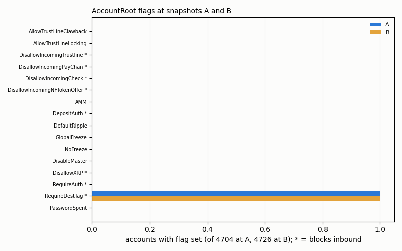
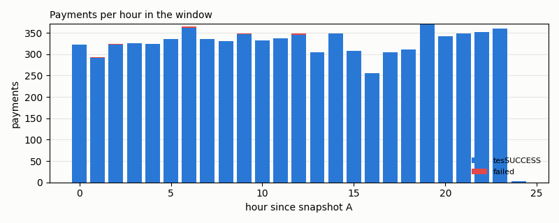

# acctflags: account settings that block inbound payments, Post Fiat testnet

Snapshot A: ledger 8122063 (2026-11-17T08:11:33Z), hash `C6A516B243A6C6CA43CA6CBACDD6D415AB4C5D34A1876E375D0AA993C3B21BF0`  
Snapshot B: ledger 8150605 (2026-11-18T08:12:01Z), hash `6C196C1753E1FB1615ABAED58CC375BF8C2675B4F4386A60B419B12540D5E8BD`  
Window: 28542 validated ledgers A+1..B, 9948 transactions, gap-free 
(every ledger chained by parent_hash, tx counts equal).  
Retry window: **100 validated ledgers** (report.config.json).

Account ids are the first 12 hex chars of HMAC-SHA256(private key, address).

## 1. Census

| | A | B |
|---|---:|---:|
| AccountRoots | 4704 | 4726 |
| any inbound-blocking flag | 1 (0.02%) | 1 (0.02%) |

Per flag (accounts with the flag set; share of all AccountRoots):

| flag | inbound-blocking | A | share A | B | share B |
|---|:---:|---:|---:|---:|---:|
| PasswordSpent |  | 0 | 0.00% | 0 | 0.00% |
| RequireDestTag | yes | 1 | 0.02% | 1 | 0.02% |
| RequireAuth | yes | 0 | 0.00% | 0 | 0.00% |
| DisallowXRP | yes | 0 | 0.00% | 0 | 0.00% |
| DisableMaster |  | 0 | 0.00% | 0 | 0.00% |
| NoFreeze |  | 0 | 0.00% | 0 | 0.00% |
| GlobalFreeze |  | 0 | 0.00% | 0 | 0.00% |
| DefaultRipple |  | 0 | 0.00% | 0 | 0.00% |
| DepositAuth | yes | 0 | 0.00% | 0 | 0.00% |
| AMM |  | 0 | 0.00% | 0 | 0.00% |
| DisallowIncomingNFTokenOffer | yes | 0 | 0.00% | 0 | 0.00% |
| DisallowIncomingCheck | yes | 0 | 0.00% | 0 | 0.00% |
| DisallowIncomingPayChan | yes | 0 | 0.00% | 0 | 0.00% |
| DisallowIncomingTrustline | yes | 0 | 0.00% | 0 | 0.00% |
| AllowTrustLineLocking |  | 0 | 0.00% | 0 | 0.00% |
| AllowTrustLineClawback |  | 0 | 0.00% | 0 | 0.00% |

Flag combinations (distinct Flags sets):

| combination | A | B |
|---|---:|---:|
| (none) | 4703 | 4725 |
| RequireDestTag | 1 | 1 |

Settings (accounts with the field present):

| setting | A | B |
|---|---:|---:|
| RegularKey | 0 | 0 |
| Domain | 2 | 2 |
| EmailHash | 0 | 0 |
| MessageKey | 149 | 149 |
| NFTokenMinter | 0 | 0 |
| WalletLocator | 0 | 0 |
| TransferRate | 0 | 0 |
| TickSize | 0 | 0 |

## 2. Reconciliation A -> B from transaction metadata

expected_B = A + set_by_tx - cleared_by_tx + created_with - deleted_with

| kind | name | A | set_by_tx | cleared_by_tx | created_with | deleted_with | expected_B | B | diff |
|---|---|---:|---:|---:|---:|---:|---:|---:|---:|
| flag | AMM | 0 | 0 | 0 | 0 | 0 | 0 | 0 | 0 |
| flag | AllowTrustLineClawback | 0 | 0 | 0 | 0 | 0 | 0 | 0 | 0 |
| flag | AllowTrustLineLocking | 0 | 0 | 0 | 0 | 0 | 0 | 0 | 0 |
| flag | DefaultRipple | 0 | 0 | 0 | 0 | 0 | 0 | 0 | 0 |
| flag | DepositAuth | 0 | 0 | 0 | 0 | 0 | 0 | 0 | 0 |
| flag | DisableMaster | 0 | 0 | 0 | 0 | 0 | 0 | 0 | 0 |
| flag | DisallowIncomingCheck | 0 | 0 | 0 | 0 | 0 | 0 | 0 | 0 |
| flag | DisallowIncomingNFTokenOffer | 0 | 0 | 0 | 0 | 0 | 0 | 0 | 0 |
| flag | DisallowIncomingPayChan | 0 | 0 | 0 | 0 | 0 | 0 | 0 | 0 |
| flag | DisallowIncomingTrustline | 0 | 0 | 0 | 0 | 0 | 0 | 0 | 0 |
| flag | DisallowXRP | 0 | 0 | 0 | 0 | 0 | 0 | 0 | 0 |
| flag | GlobalFreeze | 0 | 0 | 0 | 0 | 0 | 0 | 0 | 0 |
| flag | NoFreeze | 0 | 0 | 0 | 0 | 0 | 0 | 0 | 0 |
| flag | PasswordSpent | 0 | 0 | 0 | 0 | 0 | 0 | 0 | 0 |
| flag | RequireAuth | 0 | 0 | 0 | 0 | 0 | 0 | 0 | 0 |
| flag | RequireDestTag | 1 | 0 | 0 | 0 | 0 | 1 | 1 | 0 |
| setting | RegularKey | 0 | 0 | 0 | 0 | 0 | 0 | 0 | 0 |
| setting | Domain | 2 | 0 | 0 | 0 | 0 | 2 | 2 | 0 |
| setting | EmailHash | 0 | 0 | 0 | 0 | 0 | 0 | 0 | 0 |
| setting | MessageKey | 149 | 0 | 0 | 0 | 0 | 149 | 149 | 0 |
| setting | NFTokenMinter | 0 | 0 | 0 | 0 | 0 | 0 | 0 | 0 |
| setting | WalletLocator | 0 | 0 | 0 | 0 | 0 | 0 | 0 | 0 |
| setting | TransferRate | 0 | 0 | 0 | 0 | 0 | 0 | 0 | 0 |
| setting | TickSize | 0 | 0 | 0 | 0 | 0 | 0 | 0 | 0 |
| total | AccountRoots | 4704 | | | 22 | 0 | 4726 | 4726 | 0 |
| total | DepositPreauth pairs | 0 | | | 0 | 0 | 0 | 0 | 0 |

**Mismatches: 0** (per-account replay vs snapshot B, PreviousFields checks, totals)

## 3. Payment failures by destination settings

Payments in the window: 7933; failed: 13.

| result | count |
|---|---:|
| tecNO_DST_INSUF_XRP | 1 |
| tecUNFUNDED_PAYMENT | 12 |
| tesSUCCESS | 7920 |

Failed payments by result code and the destination's state just before the payment:

| result | destination state | count |
|---|---|---:|
| tecNO_DST_INSUF_XRP | missing | 1 |
| tecUNFUNDED_PAYMENT | no_inbound_flag | 12 |

Retries (first later tesSUCCESS Payment, same sender -> same destination, <= 100 validated ledgers): retried 3, not retried 10, censored (window reaches past B) 0.

| fix | count |
|---|---:|
| dest_tag_fix | 0 |
| preauth_fix | 0 |
| flag_cleared | 0 |
| other | 3 |

| ledger | sender | destination | result | dest state | tag | retry after (ledgers) | fix |
|---:|---|---|---|---|:---:|---:|---|
| 8123808 | aa80b8a8c237 | 73196c4f7b57 | tecUNFUNDED_PAYMENT | no_inbound_flag | n |  | none |
| 8123811 | aa80b8a8c237 | 73196c4f7b57 | tecUNFUNDED_PAYMENT | no_inbound_flag | n |  | none |
| 8123814 | aa80b8a8c237 | 73196c4f7b57 | tecUNFUNDED_PAYMENT | no_inbound_flag | n |  | none |
| 8125066 | 2652fcf027cc | f174fe618217 | tecUNFUNDED_PAYMENT | no_inbound_flag | n |  | none |
| 8125069 | 2652fcf027cc | f174fe618217 | tecUNFUNDED_PAYMENT | no_inbound_flag | n |  | none |
| 8125073 | 2652fcf027cc | f174fe618217 | tecUNFUNDED_PAYMENT | no_inbound_flag | n |  | none |
| 8129962 | c0d8bc3bf68b | f95c0363295b | tecUNFUNDED_PAYMENT | no_inbound_flag | n | 98 | other |
| 8129965 | c0d8bc3bf68b | f95c0363295b | tecUNFUNDED_PAYMENT | no_inbound_flag | n | 95 | other |
| 8129969 | c0d8bc3bf68b | f95c0363295b | tecUNFUNDED_PAYMENT | no_inbound_flag | n | 91 | other |
| 8133781 | 85070b7f2426 | cd0beed4905d | tecNO_DST_INSUF_XRP | missing | n |  | none |
| 8137503 | 2652fcf027cc | f95c0363295b | tecUNFUNDED_PAYMENT | no_inbound_flag | n |  | none |
| 8137506 | 2652fcf027cc | f95c0363295b | tecUNFUNDED_PAYMENT | no_inbound_flag | n |  | none |
| 8137510 | 2652fcf027cc | f95c0363295b | tecUNFUNDED_PAYMENT | no_inbound_flag | n |  | none |

## 4. Public RPC crosscheck

| snapshot | ledger | accounts | checks | match | mismatch | negative control mismatches |
|---|---:|---:|---:|---:|---:|---:|
| A | 8122063 | 24 | 25 | 25 | 0 | 24 of 24 |
| B | 8150605 | 24 | 25 | 25 | 0 | 24 of 24 |

