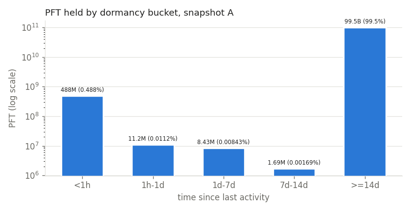
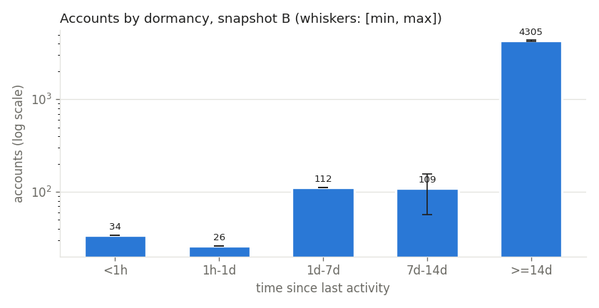
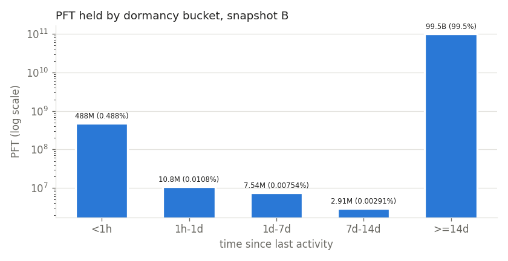
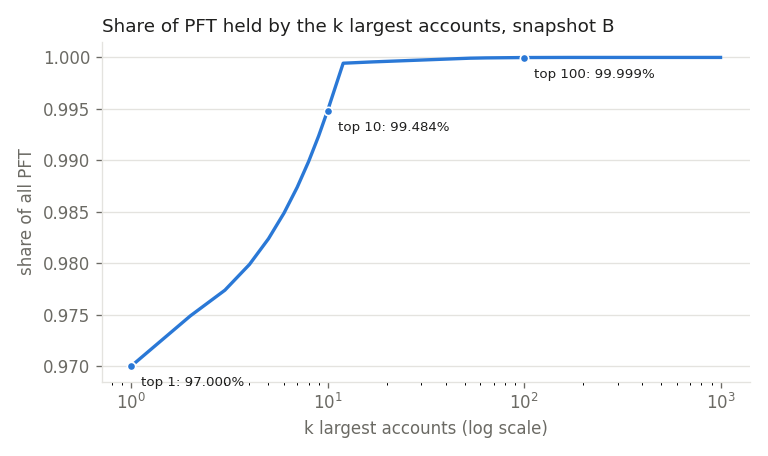
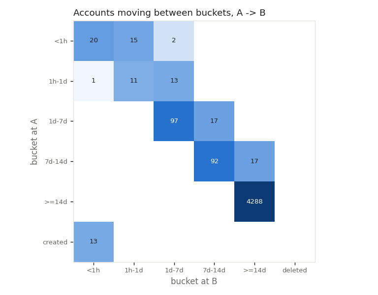

# Account dormancy report

Generated by `dormancy/analyze_dormancy.py` from committed data only; every figure is in `dormancy.json`. Amounts are exact (integer drops, 1 PFT = 1,000,000 drops).

## Snapshots

|  | ledger | ledger hash | close time | objects | accounts | total_coins (PFT) |
|---|---|---|---|---|---|---|
| A | 7874004 | `793B89EB45C4625A49391C233FA64A6ED3D346A7250FEBDABBE75C03332671E0` | 2026-11-08T15:38:40Z | 5106 | 4573 | 99,999,999,967.938708 |
| B | 7902546 | `1985DB3870F2BDB5C2485A8A963E60A01E50B82834F8D639EBCDDB2C8594D5DD` | 2026-11-09T15:38:50Z | 5113 | 4586 | 99,999,999,967.839710 |

Time map: 146 committed anchors + 116 fetched headers = 236 exact headers.

## Snapshot A (ledger 7874004)

Last-activity time source: exact 201, interp 152 (bound width max 151.95 h, median 151.95 h), before 4220 (older than the oldest known header 7352333 at 2026-10-21T09:11:50Z, i.e. age >= 18.269 d).

| bucket | accounts | [min, max] | exact/interp/before | balance (PFT) | reserve (PFT) | OwnerCount | Gini | top-10 share |
|---|---|---|---|---|---|---|---|---|
| <1h | 37 | [37, 37] | 37/0/0 | 488,260,440.842408 | 456.000000 | 43 | 0.972947 | 0.999994 |
| 1h-1d | 25 | [25, 25] | 25/0/0 | 11,182,919.253863 | 324.000000 | 37 | 0.771837 | 0.979313 |
| 1d-7d | 114 | [114, 114] | 65/49/0 | 8,427,603.897249 | 1,198.000000 | 29 | 0.95781 | 0.998457 |
| 7d-14d | 109 | [40, 140] | 40/69/0 | 1,694,039.681714 | 1,108.000000 | 9 | 0.98952 | 0.999128 |
| >=14d | 4288 | [4257, 4357] | 34/34/4220 | 99,490,434,964.263474 | 43,357.999768 | 239 | 0.999699 | 0.997459 |

`[min, max]`: accounts whose whole age interval lies in the bucket / that the interval touches. The point count always lies between them (check `bounds_hold`).

All accounts: Gini 0.999702, top-10 share 0.994837. Reserve params: base 10.000000 + 2.000000 per owned object (reserve per account = min(balance, base + inc x OwnerCount)).

| OwnerCount -> | 0 | 1 | 2-5 | 6-20 | >20 |
|---|---|---|---|---|---|
| <1h | 4 | 26 | 7 | 0 | 0 |
| 1h-1d | 12 | 7 | 4 | 2 | 0 |
| 1d-7d | 106 | 3 | 3 | 2 | 0 |
| 7d-14d | 107 | 1 | 0 | 1 | 0 |
| >=14d | 4193 | 73 | 13 | 8 | 1 |

| # | account | balance (PFT) | OwnerCount | bucket | time source |
|---|---|---|---|---|---|
| 1 | `r4vhrMChCsaoFsBoCkRTRGUuc1njfr7bmA` | 96,999,999,999.999880 | 0 | >=14d | before |
| 2 | `rwdm72S9YVKkZjeADKU2bbUMuY4vPnSfH7` | 488,172,345.807986 | 1 | <1h | exact |
| 3 | `rD9LaW5h5AeGoHsPARWNegfZs3XpeNrv9w` | 250,000,000.000000 | 0 | >=14d | before |
| 4 | `rJNBxuus1TjCq3pikYUsKUXXwyBsJqQAt9` | 250,000,000.000000 | 0 | >=14d | before |
| 5 | `rs3YdBLJHFGhcPKtbMwQgkbrpo1YjyajTP` | 250,000,000.000000 | 0 | >=14d | before |
| 6 | `rscWPz4aA4GtQKH5tYvVFwteiSSjTjounC` | 250,000,000.000000 | 0 | >=14d | before |
| 7 | `rBDbRYd8H7gB6mdNTRssgNvsw8Z6c4riDb` | 249,952,699.999892 | 0 | >=14d | before |
| 8 | `rhczhWeG3eSohzcH5jw8m8Ynca9cgH4eZm` | 249,714,196.430448 | 0 | >=14d | before |
| 9 | `rKddMw1hqMGwfgJvzjbWQHtBQT8hDcZNCP` | 248,880,686.825979 | 0 | >=14d | before |
| 10 | `rJNwqDPKSkbqDPNoNxbW6C3KCS84ZaQc96` | 246,963,444.567100 | 0 | >=14d | before |

Reconciliation (exact integers):

| check | result | detail |
|---|---|---|
| objects_paged | OK | 5106 vs 5106 |
| accounts_in_buckets | OK | 4573 vs 4573 |
| balance_in_buckets | OK | 99999999967938708 vs 99999999967938708 |
| reserve_in_buckets | OK | sum of bucket reserves = sum of account reserves |
| owner_count_in_buckets | OK | owner counts |
| total_coins | OK | balances 99999999967938708 + escrow 0 + paychan 0 vs 99999999967938708 |
| no_unbucketed | OK | every account has a bucket |
| bounds_hold | OK | min <= point <= max per bucket |

## Snapshot B (ledger 7902546)

Last-activity time source: exact 214, interp 152 (bound width max 151.95 h, median 151.95 h), before 4220 (older than the oldest known header 7352333 at 2026-10-21T09:11:50Z, i.e. age >= 19.269 d).

| bucket | accounts | [min, max] | exact/interp/before | balance (PFT) | reserve (PFT) | OwnerCount | Gini | top-10 share |
|---|---|---|---|---|---|---|---|---|
| <1h | 34 | [34, 34] | 34/0/0 | 488,266,151.343647 | 412.000000 | 36 | 0.970559 | 0.999995 |
| 1h-1d | 26 | [26, 26] | 26/0/0 | 10,848,711.340758 | 332.000000 | 36 | 0.798531 | 0.995317 |
| 1d-7d | 112 | [112, 112] | 63/49/0 | 7,540,070.200925 | 1,174.000000 | 27 | 0.959638 | 0.997088 |
| 7d-14d | 109 | [57, 157] | 57/52/0 | 2,906,258.691062 | 1,116.000000 | 13 | 0.982275 | 0.999492 |
| >=14d | 4305 | [4257, 4357] | 34/51/4220 | 99,490,438,776.263318 | 43,527.999768 | 239 | 0.999701 | 0.997459 |

`[min, max]`: accounts whose whole age interval lies in the bucket / that the interval touches. The point count always lies between them (check `bounds_hold`).

All accounts: Gini 0.999702, top-10 share 0.994837. Reserve params: base 10.000000 + 2.000000 per owned object (reserve per account = min(balance, base + inc x OwnerCount)).

| OwnerCount -> | 0 | 1 | 2-5 | 6-20 | >20 |
|---|---|---|---|---|---|
| <1h | 4 | 24 | 6 | 0 | 0 |
| 1h-1d | 14 | 6 | 4 | 2 | 0 |
| 1d-7d | 103 | 5 | 2 | 2 | 0 |
| 7d-14d | 106 | 1 | 1 | 1 | 0 |
| >=14d | 4210 | 73 | 13 | 8 | 1 |

| # | account | balance (PFT) | OwnerCount | bucket | time source |
|---|---|---|---|---|---|
| 1 | `r4vhrMChCsaoFsBoCkRTRGUuc1njfr7bmA` | 96,999,999,999.999880 | 0 | >=14d | before |
| 2 | `rwdm72S9YVKkZjeADKU2bbUMuY4vPnSfH7` | 488,142,996.557313 | 1 | <1h | exact |
| 3 | `rD9LaW5h5AeGoHsPARWNegfZs3XpeNrv9w` | 250,000,000.000000 | 0 | >=14d | before |
| 4 | `rJNBxuus1TjCq3pikYUsKUXXwyBsJqQAt9` | 250,000,000.000000 | 0 | >=14d | before |
| 5 | `rs3YdBLJHFGhcPKtbMwQgkbrpo1YjyajTP` | 250,000,000.000000 | 0 | >=14d | before |
| 6 | `rscWPz4aA4GtQKH5tYvVFwteiSSjTjounC` | 250,000,000.000000 | 0 | >=14d | before |
| 7 | `rBDbRYd8H7gB6mdNTRssgNvsw8Z6c4riDb` | 249,952,699.999892 | 0 | >=14d | before |
| 8 | `rhczhWeG3eSohzcH5jw8m8Ynca9cgH4eZm` | 249,714,196.430448 | 0 | >=14d | before |
| 9 | `rKddMw1hqMGwfgJvzjbWQHtBQT8hDcZNCP` | 248,880,686.825979 | 0 | >=14d | before |
| 10 | `rJNwqDPKSkbqDPNoNxbW6C3KCS84ZaQc96` | 246,963,444.567100 | 0 | >=14d | before |

Reconciliation (exact integers):

| check | result | detail |
|---|---|---|
| objects_paged | OK | 5113 vs 5113 |
| accounts_in_buckets | OK | 4586 vs 4586 |
| balance_in_buckets | OK | 99999999967839710 vs 99999999967839710 |
| reserve_in_buckets | OK | sum of bucket reserves = sum of account reserves |
| owner_count_in_buckets | OK | owner counts |
| total_coins | OK | balances 99999999967839710 + escrow 0 + paychan 0 vs 99999999967839710 |
| no_unbucketed | OK | every account has a bucket |
| bounds_hold | OK | min <= point <= max per bucket |

## Transitions A -> B

Touched (new PreviousTxnID) 47, untouched 4526, created 13, deleted 0.

| A \ B | <1h | 1h-1d | 1d-7d | 7d-14d | >=14d | deleted |
|---|---|---|---|---|---|---|
| <1h | 20 | 15 | 2 | 0 | 0 | 0 |
| 1h-1d | 1 | 11 | 13 | 0 | 0 | 0 |
| 1d-7d | 0 | 0 | 97 | 17 | 0 | 0 |
| 7d-14d | 0 | 0 | 0 | 92 | 17 | 0 |
| >=14d | 0 | 0 | 0 | 0 | 4288 | 0 |
| created | 13 | 0 | 0 | 0 | 0 |  |

| check | result | detail |
|---|---|---|
| accounts_conserved | OK | 4573 - 0 + 13 vs 4586 |
| matrix_covers_a | OK | every A account has exactly one A->B cell |
| touched_plus_untouched | OK | 47 + 4526 + 0 vs 4573 |
| invariants | OK | 0 problems |

## Charts

Overall: PASS
