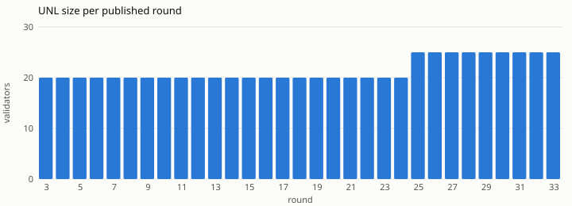
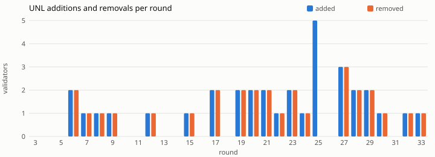
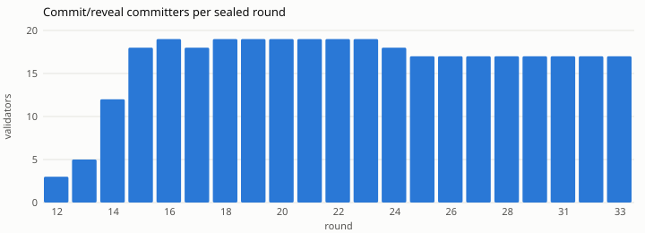

# Dynamic UNL round history and consistency audit (Post Fiat testnet)

Generated by `dunl/audit_dunl.py` from public data only: the scoring service API, the
mirrored VL, public JSON-RPC transactions, and `validators` snapshots of this operator's own two
nodes. Inputs are pinned below; the same inputs reproduce this file byte for byte.

- collection epoch: `2026-11-26`; input pack sha256 `d286b3bab99f31a35da72f9de0086d3b61f83f168816d1e2ba1564897900c01b`
- rounds listed: 32 (rounds 2..33); with a signed VL: 31
- transactions checked: 737
- node snapshots: sentry 2026-11-26T05:43:35Z, validator 2026-11-26T05:43:34Z

## Check results

**178 PASS, 56 WARN, 0 FAIL** (234 results; full list with reasons in `checks.json`).

| check | PASS | WARN | FAIL |
|---|---:|---:|---:|
| anchor | 1 | 30 | 0 |
| bundle_hashes | 27 | 4 | 0 |
| convergence | 1 | 21 | 0 |
| mirror | 3 | 0 | 0 |
| nodes | 3 | 0 | 0 |
| selection | 18 | 0 | 0 |
| sequence | 31 | 1 | 0 |
| validator_set | 31 | 0 | 0 |
| validity_window | 32 | 0 | 0 |
| vl_decode | 31 | 0 | 0 |

Every non-PASS result:

- **WARN** `sequence` round 2: status FAILED: no signed VL published
- **WARN** `bundle_hashes` round 3: legacy layout: no bundle.json / file_hashes
- **WARN** `bundle_hashes` round 4: legacy layout: no bundle.json / file_hashes
- **WARN** `bundle_hashes` round 5: legacy layout: no bundle.json / file_hashes
- **WARN** `bundle_hashes` round 6: legacy layout: no bundle.json / file_hashes
- **WARN** `anchor` round 3: status VL_PUBLISHED_MEMO_FAILED: VL published without an on-chain memo
- **WARN** `anchor` round 4: memo tx 0290FA98B6B3.. not verifiable: round completed 2026-05-05T16:57, before the retained history (public RPC keeps ledgers 8300055-8375832 (first closed 2026-11-23T14:02:51Z))
- **WARN** `anchor` round 5: memo tx 15B9D75CF11E.. not verifiable: round completed 2026-05-12T17:03, before the retained history (public RPC keeps ledgers 8300055-8375832 (first closed 2026-11-23T14:02:51Z))
- **WARN** `anchor` round 6: memo tx CE4F9490CD49.. not verifiable: round completed 2026-05-19T17:10, before the retained history (public RPC keeps ledgers 8300055-8375832 (first closed 2026-11-23T14:02:51Z))
- **WARN** `anchor` round 7: memo tx 12FE5A2787E4.. not verifiable: round completed 2026-05-26T17:20, before the retained history (public RPC keeps ledgers 8300055-8375832 (first closed 2026-11-23T14:02:51Z))
- **WARN** `anchor` round 8: memo tx 362FBB2CA8CB.. not verifiable: round completed 2026-06-02T17:33, before the retained history (public RPC keeps ledgers 8300055-8375832 (first closed 2026-11-23T14:02:51Z))
- **WARN** `anchor` round 9: memo tx 6EDF08FFFF10.. not verifiable: round completed 2026-06-09T17:43, before the retained history (public RPC keeps ledgers 8300055-8375832 (first closed 2026-11-23T14:02:51Z))
- **WARN** `anchor` round 10: memo tx 53493678D401.. not verifiable: round completed 2026-06-16T17:57, before the retained history (public RPC keeps ledgers 8300055-8375832 (first closed 2026-11-23T14:02:51Z))
- **WARN** `anchor` round 11: memo tx D0A7979618CF.. not verifiable: round completed 2026-06-23T18:11, before the retained history (public RPC keeps ledgers 8300055-8375832 (first closed 2026-11-23T14:02:51Z))
- **WARN** `anchor` round 12: memo tx 979B1D95A8B0.. not verifiable: round completed 2026-06-30T18:44, before the retained history (public RPC keeps ledgers 8300055-8375832 (first closed 2026-11-23T14:02:51Z))
- **WARN** `anchor` round 13: memo tx 34442EE50023.. not verifiable: round completed 2026-07-07T21:53, before the retained history (public RPC keeps ledgers 8300055-8375832 (first closed 2026-11-23T14:02:51Z))
- **WARN** `anchor` round 14: memo tx D06AA836409C.. not verifiable: round completed 2026-07-15T01:05, before the retained history (public RPC keeps ledgers 8300055-8375832 (first closed 2026-11-23T14:02:51Z))
- **WARN** `anchor` round 15: memo tx F0A731AEFC92.. not verifiable: round completed 2026-07-21T19:07, before the retained history (public RPC keeps ledgers 8300055-8375832 (first closed 2026-11-23T14:02:51Z))
- **WARN** `anchor` round 16: memo tx 08F361F8FD78.. not verifiable: round completed 2026-07-28T19:12, before the retained history (public RPC keeps ledgers 8300055-8375832 (first closed 2026-11-23T14:02:51Z))
- **WARN** `anchor` round 17: memo tx A4C92AFAFD45.. not verifiable: round completed 2026-08-04T19:15, before the retained history (public RPC keeps ledgers 8300055-8375832 (first closed 2026-11-23T14:02:51Z))
- **WARN** `anchor` round 18: memo tx 390D2CB34AAB.. not verifiable: round completed 2026-08-11T19:15, before the retained history (public RPC keeps ledgers 8300055-8375832 (first closed 2026-11-23T14:02:51Z))
- **WARN** `anchor` round 19: memo tx 8B7B142BFBA0.. not verifiable: round completed 2026-08-18T19:14, before the retained history (public RPC keeps ledgers 8300055-8375832 (first closed 2026-11-23T14:02:51Z))
- **WARN** `anchor` round 20: memo tx D77106CB159C.. not verifiable: round completed 2026-08-25T19:11, before the retained history (public RPC keeps ledgers 8300055-8375832 (first closed 2026-11-23T14:02:51Z))
- **WARN** `anchor` round 21: memo tx 3B8B391E1E4C.. not verifiable: round completed 2026-09-01T19:10, before the retained history (public RPC keeps ledgers 8300055-8375832 (first closed 2026-11-23T14:02:51Z))
- **WARN** `anchor` round 22: memo tx 2D1520D17ED5.. not verifiable: round completed 2026-09-08T19:15, before the retained history (public RPC keeps ledgers 8300055-8375832 (first closed 2026-11-23T14:02:51Z))
- **WARN** `anchor` round 23: memo tx 6D7F7900679B.. not verifiable: round completed 2026-09-15T19:15, before the retained history (public RPC keeps ledgers 8300055-8375832 (first closed 2026-11-23T14:02:51Z))
- **WARN** `anchor` round 24: memo tx 089364847A4E.. not verifiable: round completed 2026-09-22T19:12, before the retained history (public RPC keeps ledgers 8300055-8375832 (first closed 2026-11-23T14:02:51Z))
- **WARN** `anchor` round 25: memo tx F3C2AC58B83C.. not verifiable: round completed 2026-09-29T19:13, before the retained history (public RPC keeps ledgers 8300055-8375832 (first closed 2026-11-23T14:02:51Z))
- **WARN** `anchor` round 26: memo tx 77408B83E65A.. not verifiable: round completed 2026-10-06T19:11, before the retained history (public RPC keeps ledgers 8300055-8375832 (first closed 2026-11-23T14:02:51Z))
- **WARN** `anchor` round 27: memo tx 243EA6FE9398.. not verifiable: round completed 2026-10-13T19:11, before the retained history (public RPC keeps ledgers 8300055-8375832 (first closed 2026-11-23T14:02:51Z))
- **WARN** `anchor` round 28: memo tx 9EC84EAC9C7E.. not verifiable: round completed 2026-10-20T19:20, before the retained history (public RPC keeps ledgers 8300055-8375832 (first closed 2026-11-23T14:02:51Z))
- **WARN** `anchor` round 29: memo tx 47155A4D5A3D.. not verifiable: round completed 2026-10-27T19:15, before the retained history (public RPC keeps ledgers 8300055-8375832 (first closed 2026-11-23T14:02:51Z))
- **WARN** `anchor` round 30: memo tx C805308AC229.. not verifiable: round completed 2026-11-03T19:14, before the retained history (public RPC keeps ledgers 8300055-8375832 (first closed 2026-11-23T14:02:51Z))
- **WARN** `anchor` round 31: memo tx 9C187C0A51D5.. not verifiable: round completed 2026-11-10T19:17, before the retained history (public RPC keeps ledgers 8300055-8375832 (first closed 2026-11-23T14:02:51Z))
- **WARN** `anchor` round 32: memo tx 71FB6C61F380.. not verifiable: round completed 2026-11-17T19:15, before the retained history (public RPC keeps ledgers 8300055-8375832 (first closed 2026-11-23T14:02:51Z))
- **WARN** `convergence` round 12: sealed; 3 participants, summary == recount; 0/6 commit/reveal txs validated tesSUCCESS; anchor tx not verifiable (pruned); 6 commit/reveal txs not verifiable (pruned) (public RPC keeps ledgers 8300055-8375832 (first closed 2026-11-23T14:02:51Z))
- **WARN** `convergence` round 13: sealed; 5 participants, summary == recount; 0/10 commit/reveal txs validated tesSUCCESS; anchor tx not verifiable (pruned); 10 commit/reveal txs not verifiable (pruned) (public RPC keeps ledgers 8300055-8375832 (first closed 2026-11-23T14:02:51Z))
- **WARN** `convergence` round 14: sealed; 12 participants, summary == recount; 0/24 commit/reveal txs validated tesSUCCESS; anchor tx not verifiable (pruned); 24 commit/reveal txs not verifiable (pruned) (public RPC keeps ledgers 8300055-8375832 (first closed 2026-11-23T14:02:51Z))
- **WARN** `convergence` round 15: sealed; 18 participants, summary == recount; 0/36 commit/reveal txs validated tesSUCCESS; anchor tx not verifiable (pruned); 36 commit/reveal txs not verifiable (pruned) (public RPC keeps ledgers 8300055-8375832 (first closed 2026-11-23T14:02:51Z))
- **WARN** `convergence` round 16: sealed; 19 participants, summary == recount; 0/38 commit/reveal txs validated tesSUCCESS; anchor tx not verifiable (pruned); 38 commit/reveal txs not verifiable (pruned) (public RPC keeps ledgers 8300055-8375832 (first closed 2026-11-23T14:02:51Z))
- **WARN** `convergence` round 17: sealed; 18 participants, summary == recount; 0/36 commit/reveal txs validated tesSUCCESS; anchor tx not verifiable (pruned); 36 commit/reveal txs not verifiable (pruned) (public RPC keeps ledgers 8300055-8375832 (first closed 2026-11-23T14:02:51Z))
- **WARN** `convergence` round 18: sealed; 19 participants, summary == recount; 0/38 commit/reveal txs validated tesSUCCESS; anchor tx not verifiable (pruned); 38 commit/reveal txs not verifiable (pruned) (public RPC keeps ledgers 8300055-8375832 (first closed 2026-11-23T14:02:51Z))
- **WARN** `convergence` round 19: sealed; 19 participants, summary == recount; 0/38 commit/reveal txs validated tesSUCCESS; anchor tx not verifiable (pruned); 38 commit/reveal txs not verifiable (pruned) (public RPC keeps ledgers 8300055-8375832 (first closed 2026-11-23T14:02:51Z))
- **WARN** `convergence` round 20: sealed; 19 participants, summary == recount; 0/38 commit/reveal txs validated tesSUCCESS; anchor tx not verifiable (pruned); 38 commit/reveal txs not verifiable (pruned) (public RPC keeps ledgers 8300055-8375832 (first closed 2026-11-23T14:02:51Z))
- **WARN** `convergence` round 21: sealed; 19 participants, summary == recount; 0/38 commit/reveal txs validated tesSUCCESS; anchor tx not verifiable (pruned); 38 commit/reveal txs not verifiable (pruned) (public RPC keeps ledgers 8300055-8375832 (first closed 2026-11-23T14:02:51Z))
- **WARN** `convergence` round 22: sealed; 19 participants, summary == recount; 0/38 commit/reveal txs validated tesSUCCESS; anchor tx not verifiable (pruned); 38 commit/reveal txs not verifiable (pruned) (public RPC keeps ledgers 8300055-8375832 (first closed 2026-11-23T14:02:51Z))
- **WARN** `convergence` round 23: sealed; 19 participants, summary == recount; 0/38 commit/reveal txs validated tesSUCCESS; anchor tx not verifiable (pruned); 38 commit/reveal txs not verifiable (pruned) (public RPC keeps ledgers 8300055-8375832 (first closed 2026-11-23T14:02:51Z))
- **WARN** `convergence` round 24: sealed; 18 participants, summary == recount; 0/36 commit/reveal txs validated tesSUCCESS; anchor tx not verifiable (pruned); 36 commit/reveal txs not verifiable (pruned) (public RPC keeps ledgers 8300055-8375832 (first closed 2026-11-23T14:02:51Z))
- **WARN** `convergence` round 25: sealed; 17 participants, summary == recount; 0/34 commit/reveal txs validated tesSUCCESS; anchor tx not verifiable (pruned); 34 commit/reveal txs not verifiable (pruned) (public RPC keeps ledgers 8300055-8375832 (first closed 2026-11-23T14:02:51Z))
- **WARN** `convergence` round 26: sealed; 17 participants, summary == recount; 0/34 commit/reveal txs validated tesSUCCESS; anchor tx not verifiable (pruned); 34 commit/reveal txs not verifiable (pruned) (public RPC keeps ledgers 8300055-8375832 (first closed 2026-11-23T14:02:51Z))
- **WARN** `convergence` round 27: sealed; 17 participants, summary == recount; 0/34 commit/reveal txs validated tesSUCCESS; anchor tx not verifiable (pruned); 34 commit/reveal txs not verifiable (pruned) (public RPC keeps ledgers 8300055-8375832 (first closed 2026-11-23T14:02:51Z))
- **WARN** `convergence` round 28: sealed; 17 participants, summary == recount; 0/34 commit/reveal txs validated tesSUCCESS; anchor tx not verifiable (pruned); 34 commit/reveal txs not verifiable (pruned) (public RPC keeps ledgers 8300055-8375832 (first closed 2026-11-23T14:02:51Z))
- **WARN** `convergence` round 29: phase not_tracked although the round is a normal COMPLETE round with a frozen input package (Qmdtr2febBtC6HvsaQGo3iZ9h57stjowoP2VhvZ4eUMEUt, frozen 2026-10-27T16:13) after convergence tracking began (round 12): no sealed report
- **WARN** `convergence` round 30: sealed; 17 participants, summary == recount; 0/34 commit/reveal txs validated tesSUCCESS; anchor tx not verifiable (pruned); 34 commit/reveal txs not verifiable (pruned) (public RPC keeps ledgers 8300055-8375832 (first closed 2026-11-23T14:02:51Z))
- **WARN** `convergence` round 31: sealed; 17 participants, summary == recount; 0/34 commit/reveal txs validated tesSUCCESS; anchor tx not verifiable (pruned); 34 commit/reveal txs not verifiable (pruned) (public RPC keeps ledgers 8300055-8375832 (first closed 2026-11-23T14:02:51Z))
- **WARN** `convergence` round 32: sealed; 17 participants, summary == recount; 0/34 commit/reveal txs validated tesSUCCESS; anchor tx not verifiable (pruned); 34 commit/reveal txs not verifiable (pruned) (public RPC keeps ledgers 8300055-8375832 (first closed 2026-11-23T14:02:51Z))

## Membership and churn

UNL size ranged 20..25 (latest 25). Across 30 transitions the list changed 20 times: 34 additions, 29 removals (`membership.csv`).

## Tenure

40 distinct validators were on at least one published list; 5 were on every one, 1 on exactly one (`tenure.csv`). Top 10 by rounds:

| validator | rounds in UNL | share % | longest streak | first | last | in latest |
|---|---:|---:|---:|---:|---:|---:|
| `nHBM2nzq3pZUg8Js..` | 31 | 100.0 | 31 | 3 | 33 | 1 |
| `nHBcLEB4S6moQGrh..` | 31 | 100.0 | 31 | 3 | 33 | 1 |
| `nHU74qX4tCQDSpE6..` | 31 | 100.0 | 31 | 3 | 33 | 1 |
| `nHUCEXpC5LhFAm1M..` | 31 | 100.0 | 31 | 3 | 33 | 1 |
| `nHUUXMXfPEdnKAT8..` | 31 | 100.0 | 31 | 3 | 33 | 1 |
| `nHUzc5XzsmweRV6a..` | 29 | 93.5 | 15 | 3 | 33 | 1 |
| `nHUWciHX8W9PgM3s..` | 28 | 90.3 | 28 | 6 | 33 | 1 |
| `nHD3sPmhNtVXTXrZ..` | 27 | 87.1 | 14 | 3 | 33 | 1 |
| `nHUdwzTWTQJzebbx..` | 27 | 87.1 | 15 | 3 | 33 | 1 |
| `nHUkhbZe9ncdmhn6..` | 26 | 83.9 | 26 | 3 | 28 | 0 |

## Scores

`scores.csv` has 1031 per-validator final scores over 18 rounds with a final_scores.json. Round 33: 66 scored, 25 selected (lowest selected score 89), highest unselected 91; configured score cutoff 40. An alternate can outscore the lowest member because a challenger must beat the weakest incumbent by the min score gap; the `selection` check replays this rule for every round with published scores.

## Entry times

When each list became effective relative to round completion and to its on-chain anchor (`entry_times.csv`):

| round | seq | completed | anchor close time | effective | effective - anchor (h) | validity (days) |
|---:|---:|---|---|---|---:|---:|
| 3 | 1 | 2026-05-05T16:48 |  | 2026-05-05T17:18 |  | 500.0 |
| 4 | 2 | 2026-05-05T16:57 |  | 2026-05-05T17:27 |  | 500.0 |
| 5 | 3 | 2026-05-12T17:03 |  | 2026-05-12T17:33 |  | 500.0 |
| 6 | 4 | 2026-05-19T17:10 |  | 2026-05-19T17:40 |  | 500.0 |
| 7 | 5 | 2026-05-26T17:20 |  | 2026-05-26T17:50 |  | 500.0 |
| 8 | 6 | 2026-06-02T17:33 |  | 2026-06-02T18:02 |  | 500.0 |
| 9 | 7 | 2026-06-09T17:43 |  | 2026-06-09T18:13 |  | 500.0 |
| 10 | 8 | 2026-06-16T17:57 |  | 2026-06-16T18:27 |  | 500.0 |
| 11 | 9 | 2026-06-23T18:11 |  | 2026-06-23T18:39 |  | 500.0 |
| 12 | 10 | 2026-06-30T18:44 |  | 2026-06-30T19:14 |  | 500.0 |
| 13 | 11 | 2026-07-07T21:53 |  | 2026-07-07T22:49 |  | 499.8 |
| 14 | 12 | 2026-07-15T01:05 |  | 2026-07-15T02:01 |  | 499.8 |
| 15 | 13 | 2026-07-21T19:07 |  | 2026-07-21T20:07 |  | 499.8 |
| 16 | 14 | 2026-07-28T19:12 |  | 2026-07-28T20:08 |  | 499.8 |
| 17 | 15 | 2026-08-04T19:15 |  | 2026-08-04T20:10 |  | 499.8 |
| 18 | 16 | 2026-08-11T19:15 |  | 2026-08-11T20:10 |  | 499.8 |
| 19 | 17 | 2026-08-18T19:14 |  | 2026-08-18T20:10 |  | 499.8 |
| 20 | 18 | 2026-08-25T19:11 |  | 2026-08-25T20:09 |  | 499.8 |
| 21 | 19 | 2026-09-01T19:10 |  | 2026-09-01T20:06 |  | 499.8 |
| 22 | 20 | 2026-09-08T19:15 |  | 2026-09-08T20:10 |  | 499.8 |
| 23 | 21 | 2026-09-15T19:15 |  | 2026-09-15T20:11 |  | 499.8 |
| 24 | 22 | 2026-09-22T19:12 |  | 2026-09-22T20:08 |  | 499.8 |
| 25 | 23 | 2026-09-29T19:13 |  | 2026-09-29T20:08 |  | 499.8 |
| 26 | 24 | 2026-10-06T19:11 |  | 2026-10-06T20:07 |  | 499.8 |
| 27 | 25 | 2026-10-13T19:11 |  | 2026-10-13T20:06 |  | 499.8 |
| 28 | 26 | 2026-10-20T19:20 |  | 2026-10-20T20:14 |  | 499.8 |
| 29 | 27 | 2026-10-27T19:15 |  | 2026-10-27T20:13 |  | 499.8 |
| 30 | 28 | 2026-11-03T19:14 |  | 2026-11-03T20:10 |  | 499.8 |
| 31 | 29 | 2026-11-10T19:17 |  | 2026-11-10T20:12 |  | 499.8 |
| 32 | 30 | 2026-11-17T19:15 |  | 2026-11-17T20:10 |  | 499.8 |
| 33 | 31 | 2026-11-24T19:16 | 2026-11-24T19:16 | 2026-11-24T20:11 | 0.92 | 499.8 |

## Participation (commit/reveal convergence)

21 sealed rounds have a convergence report (`participation.csv`). Committers ranged 3..19; divergent reveals in total: 0.

| round | committers | valid | RAW | PARSED | SELECTED_UNL | committers in UNL / UNL size |
|---:|---:|---:|---:|---:|---:|---:|
| 12 | 3 | 3 | 3 | 3 | 3 | 3 / 20 |
| 13 | 5 | 5 | 5 | 5 | 5 | 4 / 20 |
| 14 | 12 | 12 | 12 | 12 | 12 | 10 / 20 |
| 15 | 18 | 18 | 18 | 18 | 18 | 14 / 20 |
| 16 | 19 | 19 | 19 | 19 | 6 | 15 / 20 |
| 17 | 18 | 18 | 18 | 18 | 6 | 14 / 20 |
| 18 | 19 | 19 | 19 | 19 | 6 | 14 / 20 |
| 19 | 19 | 19 | 19 | 19 | 6 | 14 / 20 |
| 20 | 19 | 19 | 19 | 19 | 6 | 13 / 20 |
| 21 | 19 | 19 | 19 | 19 | 7 | 14 / 20 |
| 22 | 19 | 19 | 19 | 19 | 7 | 14 / 20 |
| 23 | 19 | 19 | 19 | 19 | 7 | 13 / 20 |
| 24 | 18 | 18 | 18 | 18 | 7 | 13 / 20 |
| 25 | 17 | 17 | 17 | 17 | 7 | 14 / 25 |
| 26 | 17 | 17 | 17 | 17 | 7 | 14 / 25 |
| 27 | 17 | 17 | 17 | 17 | 9 | 14 / 25 |
| 28 | 17 | 17 | 17 | 17 | 9 | 13 / 25 |
| 30 | 17 | 17 | 17 | 17 | 10 | 11 / 25 |
| 31 | 17 | 17 | 17 | 17 | 11 | 11 / 25 |
| 32 | 17 | 17 | 17 | 17 | 11 | 10 / 25 |
| 33 | 17 | 17 | 17 | 17 | 11 | 10 / 25 |

SELECTED_UNL below PARSED is diagnostic, not divergence: the scoring service compares only
RAW and PARSED for acceptance (`acceptance_levels` in each report).

## Own nodes

| node | snapshot | trusted keys | quorum | publisher list seq |
|---|---|---:|---:|---:|
| sentry | 2026-11-26T05:43:35Z | 25 | 17 | 31 |
| validator | 2026-11-26T05:43:34Z | 25 | 17 | 31 |

Reproduce: see `dunl/README.md`.
