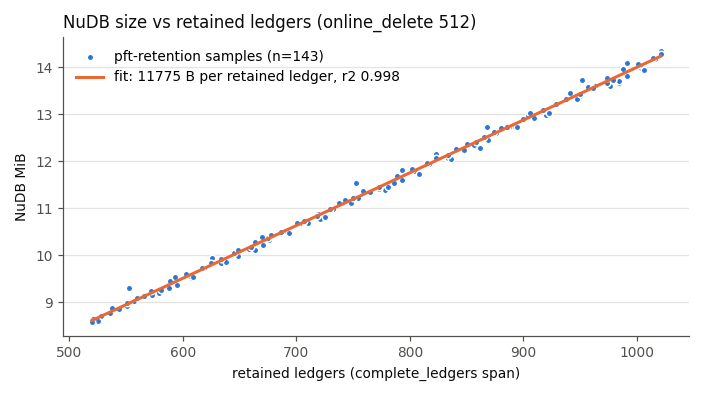
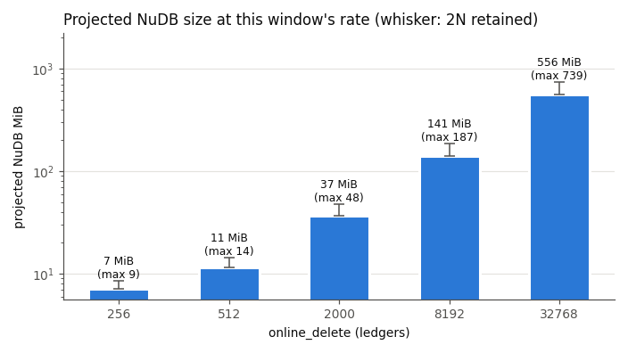
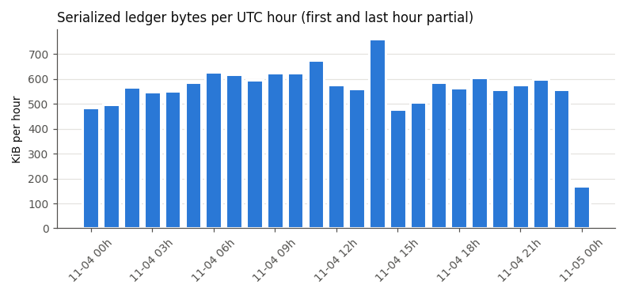

# growth report: ledger growth and node storage sizing (Post Fiat testnet)

Window: validated ledgers 7741388-7769949, close times 2026-11-04T00:11Z to 2026-11-05T00:11Z
(28,562 ledgers, 0 gaps, 0 holes, all from the local node, mean close interval 3.025 s).
Node: one validator, `online_delete=512`, NuDB/SQLite sampled every 10 min by pft-retention
(143 samples inside the window). All numbers come from [data/final/growth.json](data/final/growth.json),
recomputed offline with `--check` (IDENTICAL, [log 10](logs/10-analyze-final.log)).

## Headline

| question | answer |
|---|---:|
| serialized ledger content per ledger (header + tx_blob + meta) | 505.8 B |
| per day (28,561 ledgers) | 14.45 MB (13.78 MiB) |
| state size at window end (5,048 objects, exact serialized bytes) | 1,983,867 B (1.89 MiB) |
| state growth (two exact points, 17,780 ledgers apart) | 0.81 B/ledger, 23.1 KB/day |
| NuDB cost per retained ledger (fit, r² 0.998) | 11,775 B (23.3 × the raw 505.8 B) |
| NuDB fixed part (intercept) | 2.91 MB |
| **NuDB overhead ratio at online_delete 512** (mean NuDB / raw projection) | **5.05** (11.97 MB / 2.37 MB) |
| NuDB + SQLite at online_delete 512 (mean retained 770) | 17.8 MiB |
| full-history growth at the fitted per-ledger cost | 320.7 MiB/day, 114.3 GiB/year (estimate) |

## Sizing by online_delete

Retained ledgers = N × 1.504 (the measured mean at N = 512; the node keeps between N and 2N).
NuDB = 2,906,386 B + 11,774.9 B × retained. SQLite did not track retained ledgers (fit r² 0.004),
so it is sized as its measured mean, 6.43 MiB, for every N. Raw = state bytes + retained × 505.8 B.
CSV: [data/final/sizing.csv](data/final/sizing.csv).

| online_delete | retained mean (min-max) | raw bytes | NuDB est. (at 2N) | SQLite | NuDB + SQLite |
|---:|---:|---:|---:|---:|---:|
| 256 | 385 (256-512) | 2.08 MiB | 7.1 MiB (8.5) | 6.4 MiB | 13.5 MiB |
| 512 | 770 (512-1024) | 2.26 MiB | 11.4 MiB (14.3) | 6.4 MiB | 17.8 MiB |
| 2000 | 3008 (2000-4000) | 3.34 MiB | 36.6 MiB (47.7) | 6.4 MiB | 43.0 MiB |
| 8192 | 12321 (8192-16384) | 7.84 MiB | 141.1 MiB (186.8) | 6.4 MiB | 147.6 MiB |
| 32768 | 49284 (32768-65536) | 25.67 MiB | 556.2 MiB (738.7) | 6.4 MiB | 562.6 MiB |

Full history (labelled extrapolations, `sizing.full_history`): raw content 14.47 MB/day
(4.92 GiB/year); disk at the fitted NuDB cost 336.3 MB/day (114.3 GiB/year); a *naive* size of
all 7,769,949 ledgers at this window's per-ledger cost is 91.5 GB (85.2 GiB). Earlier ledgers
need not have cost the same.

## Measured NuDB samples (same node, same window)

| metric | min | mean | max |
|---|---:|---:|---:|
| retained ledgers (complete_ledgers span) | 520 | 770.1 | 1021 |
| retained / online_delete | 1.016 | 1.504 | 1.994 |
| NuDB bytes | 8,993,180 | 11,973,910 | 15,049,410 |
| SQLite bytes | 5,117,952 | 6,739,341 | 9,888,976 |

The 512 projection is the measurement itself: the raw projection (state 1,983,867 B + 770.07 ×
505.8 B = 2,373,378 B) against the measured NuDB mean gives the overhead ratio 5.05. Per retained
ledger NuDB costs 23.3 × the ledger's serialized content: every ledger rewrites the SHAMap inner
nodes along each changed state path and its own tx tree, and these stay until rotation.

## Where the bytes come from

Content over the window: 14,447,016 B = header 3,370,316 (23.3 %) + tx_blob 1,855,445 (12.8 %) +
metadata 9,221,255 (63.8 %). 9,924 transactions (0.35 per ledger): tesSUCCESS 9,903,
tecUNFUNDED_PAYMENT 21.

| tx type | count | tx_blob B | meta B | bytes | share of tx bytes | created | deleted |
|---|---:|---:|---:|---:|---:|---:|---:|
| Payment | 7890 | 1450106 | 2531831 | 3981937 | 35.95 % | 14 | 0 |
| NFTokenMint | 1107 | 234771 | 3743878 | 3978649 | 35.92 % | 69 | 0 |
| NFTokenBurn | 927 | 170568 | 2945546 | 3116114 | 28.13 % | 0 | 59 |

NFT transactions are 20.5 % of transactions but 64.1 % of transaction bytes: a mint averages
3,382 B and a burn 3,178 B of metadata, because the touched NFTokenPage's NFTokens array (up to 32
tokens) appears in both its FinalFields and PreviousFields. A Payment averages 505 B in total.

State objects touched: AccountRoot modified 17,779, created 14; NFTokenPage modified 1,971,
created 69, deleted 59.

## State reconciliation (snapshot A + created − deleted = snapshot B)

Snapshot A = ledger 7741387 (the ledger before the window), B = 7769949 (the last window ledger).

| LedgerEntryType | A | created | deleted | B | ok |
|---|---:|---:|---:|---:|---|
| AccountRoot | 4505 | 14 | 0 | 4519 | yes |
| Amendments | 1 | 0 | 0 | 1 | yes |
| DirectoryNode | 52 | 0 | 0 | 52 | yes |
| FeeSettings | 1 | 0 | 0 | 1 | yes |
| LedgerHashes | 120 | 0 | 0 | 120 | yes |
| NFTokenOffer | 45 | 0 | 0 | 45 | yes |
| NFTokenPage | 293 | 69 | 59 | 303 | yes |
| Offer | 3 | 0 | 0 | 3 | yes |
| RippleState | 4 | 0 | 0 | 4 | yes |

State bytes at B by type (exact, joined with snapshot B: 0/5048 problems): LedgerHashes 981,584
(49.5 %), NFTokenPage 512,551, AccountRoot 470,138, DirectoryNode 9,444, NFTokenOffer 6,662,
Amendments 2,060, RippleState 844, Offer 549, FeeSettings 35.

## Checks

| check | result | log |
|---|---|---|
| resume drill (SIGTERM + SIGKILL + injected torn/orphan rows vs uninterrupted run) | 11/11 PASS | [04](logs/04-resume-drill.log) |
| public-RPC recount, early window (20 ledgers, 10 with tx) | 20/20 OK, offline 20/20, negative 20/20 MISMATCH | [05](logs/05-crosscheck-early.log) |
| public-RPC recount, whole window (public range covered all 28,562 ledgers) | 20/20 OK, offline 20/20, negative 20/20 MISMATCH | [09](logs/09-crosscheck-final.log) |
| offline recompute (`--check`) | IDENTICAL, 0 problems | [10](logs/10-analyze-final.log) |
| tests / ruff / shellcheck | 46 growth (481 suite) passed, clean | [12](logs/12-tests-mutants.log) |
| controlled mutants | 41/41 caught (control passed) | [12](logs/12-tests-mutants.log); first run at 9d7eacd in [11](logs/11-tests-mutants-9d7eacd.log) |

Neither live recount needed a retry (`retries=0`, `retries_by_error={}`), so the RETRY/backoff
path did not run live. It is shown by fixture tests instead: the crosscheck's real public-RPC client
printing `RETRY ... backoff=2.0s / 4.0s / 8.0s` for two lgrNotFound and one transport error
(`test_retry_with_exponential_backoff_is_printed_and_counted`), REFETCH on disagreeing binary/JSON
answers, the collector's `test_backoff_is_exponential`, and mutants C13 and X6.

## Hourly

First and last hours are partial (window starts and ends at :11). Busiest full hour 14:00Z
(779,416 B, a metadata spike), quietest 15:00Z (488,872 B).
CSV: [data/final/hourly.csv](data/final/hourly.csv).

| hour (UTC) | ledgers | txns | header B | tx_blob B | meta B | raw B | created | modified | deleted |
|---|---:|---:|---:|---:|---:|---:|---:|---:|---:|
| 2026-11-04T00:00Z | 972 | 360 | 114696 | 67836 | 314514 | 497046 | 4 | 715 | 1 |
| 2026-11-04T01:00Z | 1188 | 408 | 140184 | 76061 | 292737 | 508982 | 2 | 808 | 3 |
| 2026-11-04T02:00Z | 1193 | 415 | 140774 | 77696 | 362254 | 580724 | 2 | 827 | 1 |
| 2026-11-04T03:00Z | 1190 | 410 | 140420 | 76224 | 343520 | 560164 | 5 | 820 | 2 |
| 2026-11-04T04:00Z | 1193 | 402 | 140774 | 75092 | 349407 | 565273 | 4 | 799 | 4 |
| 2026-11-04T05:00Z | 1191 | 412 | 140538 | 76388 | 382852 | 599778 | 1 | 819 | 1 |
| 2026-11-04T06:00Z | 1188 | 424 | 140184 | 78736 | 425610 | 644530 | 3 | 844 | 4 |
| 2026-11-04T07:00Z | 1188 | 408 | 140184 | 76604 | 416373 | 633161 | 7 | 803 | 7 |
| 2026-11-04T08:00Z | 1189 | 431 | 140302 | 80588 | 390200 | 611090 | 4 | 858 | 3 |
| 2026-11-04T09:00Z | 1188 | 430 | 140184 | 80164 | 418439 | 638787 | 4 | 855 | 3 |
| 2026-11-04T10:00Z | 1192 | 416 | 140656 | 78174 | 420187 | 639017 | 3 | 829 | 1 |
| 2026-11-04T11:00Z | 1190 | 427 | 140420 | 80337 | 472625 | 693382 | 9 | 846 | 5 |
| 2026-11-04T12:00Z | 1189 | 405 | 140302 | 75820 | 374195 | 590317 | 2 | 807 | 3 |
| 2026-11-04T13:00Z | 1193 | 408 | 140774 | 76471 | 356284 | 573529 | 6 | 813 | 1 |
| 2026-11-04T14:00Z | 1188 | 385 | 140184 | 71629 | 567603 | 779416 | 1 | 768 | 3 |
| 2026-11-04T15:00Z | 1191 | 380 | 140538 | 70674 | 277660 | 488872 | 2 | 753 | 2 |
| 2026-11-04T16:00Z | 1190 | 398 | 140420 | 73594 | 305565 | 519579 | 0 | 796 | 0 |
| 2026-11-04T17:00Z | 1190 | 421 | 140420 | 80354 | 378558 | 599332 | 3 | 838 | 1 |
| 2026-11-04T18:00Z | 1189 | 416 | 140302 | 78240 | 360134 | 578676 | 1 | 830 | 0 |
| 2026-11-04T19:00Z | 1190 | 426 | 140420 | 79427 | 401122 | 620969 | 4 | 850 | 3 |
| 2026-11-04T20:00Z | 1192 | 420 | 140656 | 78906 | 352256 | 571818 | 2 | 841 | 1 |
| 2026-11-04T21:00Z | 1185 | 425 | 139830 | 79146 | 372282 | 591258 | 5 | 845 | 2 |
| 2026-11-04T22:00Z | 1191 | 428 | 140538 | 79924 | 393629 | 614091 | 4 | 851 | 4 |
| 2026-11-04T23:00Z | 1191 | 398 | 140538 | 74146 | 357569 | 572253 | 3 | 794 | 3 |
| 2026-11-05T00:00Z | 221 | 71 | 26078 | 13214 | 135680 | 174972 | 2 | 141 | 1 |

## Deviations and caveats

- Only `online_delete=512` was measured (the setting this node runs). 256-32768 are projections
  from the 512 fit and the measured retained ratio, not measurements at those settings.
- The state-bytes growth rate uses the mid-window (7752169) and window-end points, 17,780 ledgers
  (62 % of the window): the exact state-bytes tool was added after the window started. Object
  counts are reconciled over the whole window.
- SQLite size did not follow retained ledgers (r² 0.004); it is sized as the measured mean.
- Full-history numbers assume every ledger costs what this window's ledgers cost, and that a
  non-rotating node writes the same per ledger as a rotating one. Treat them as estimates.
- The online_delete read in log 10 exits 2 because one of the two config paths it greps does not
  exist in the container; the other path returns `online_delete=512`.
- The published NuDB samples keep only the columns the analyzer reads (epoch to sqlite_bytes).

## Data

Hashes: [data/SHA256SUMS](data/SHA256SUMS). Row counts: [data/ROWS.txt](data/ROWS.txt).
