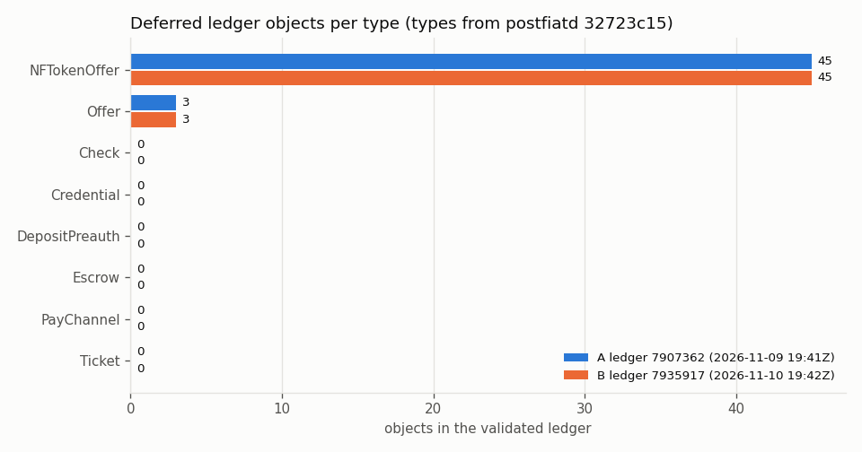
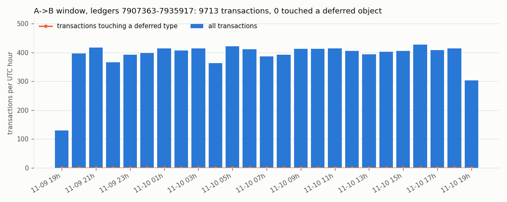

# objlife: deferred ledger objects on the Post Fiat testnet, 2026-11-09T19:41Z -> 2026-11-10T19:42Z

Read-only census of every deferred ledger object type in two validated ledgers 24 h apart, and a
replay of every transaction between them that touched one. Source: my own testnet node (postfiatd
1.0.9, build commit `32723c15e686a2088f2c83017a6ff909d93822cd`), cross-checked against
`https://rpc.testnet.postfiat.org`. Nothing was signed or submitted. How each number is made is in
[README.md](README.md); every figure below cites the committed file and line it comes from.

## Result in one paragraph

Between ledger A = 7907362 and ledger B = 7935917 (28555 ledgers, 86430 s), the network carried 9713
transactions and **none of them created, modified or deleted a deferred object**. Both ledgers hold
the same 48 deferred objects (45 NFTokenOffer, 3 Offer; 0 Escrow, Check, PayChannel, Ticket,
DepositPreauth, Credential), byte-for-byte equal apart from the header, all owned by 2 accounts,
none with a deadline, last touched between ledgers 507992 and 847665 (more than 7 million ledgers
before A). The replay over A gives exactly B (R1-R5 PASS). The public RPC agrees with both snapshots
(64/64 checks each) and with the local watcher on 200 sampled window ledgers (hash, close time, tx
count and the set of deferred-type txs: 200/200 MATCH).

## 1. Which types are deferred

8 of the 31 ledger entry types in `include/xrpl/protocol/detail/ledger_entries.macro` at the build
commit: types with `sfExpiration`, `sfCancelAfter`, `sfFinishAfter` or `sfSettleDelay`, plus Ticket
and DepositPreauth. List and macro lines: [`data/types.json`](data/types.json), run in
[`logs/01-types.log`](logs/01-types.log).

## 2. Census at A and at B



| | A | B | source |
|---|---|---|---|
| ledger | 7907362 | 7935917 | `data/analysis.json:141`, `:333` |
| close time | 2026-11-09T19:41:32Z | 2026-11-10T19:42:02Z | `data/A/snapshot.log`, `logs/11-snapshotB.log:3` |
| ledger objects paged | 5117 | 5136 | `logs/02-snapshotA.log`, `logs/11-snapshotB.log:6` |
| deferred objects | 48 | 48 | `data/analysis.json:176`, `:368` |
| NFTokenOffer / Offer | 45 / 3 | 45 / 3 | `data/analysis.json:54-63` (A), `:246-255` (B) |
| all other deferred types | 0 | 0 | same lines |
| full tree count = `ledger_data type=` count, every type | yes | yes | `logs/11-snapshotB.log:8-16` |
| owner reserve tied up (48 x 2 PFT inc) | 96000000 drops | 96000000 drops | `data/analysis.json:171-175`, `:363-367` |
| expired but not removed | 0 | 0 | `data/analysis.json:139`, `:331` |
| owners / Gini (all deferred) | 2 / 17/48 | 2 / 17/48 | `data/analysis.json:143-150`, `:335-342` |
| top owner share | 41/48 | 41/48 | `data/analysis.json:149`, `:341` |
| NFTokenOffer amounts: sell / buy | 200000000 / 205000000 drops | same | `data/analysis.json:187-188`, `:379-380` |
| Offer TakerGets / TakerPays (native) | 110000000 / 10000000 drops | same | `data/analysis.json:189-190`, `:381-382` |

The 3 Offers also carry one IOU leg each (currency DLK, `data/analysis.json:179-185`). Of the 45
NFTokenOffers, 43 are sell offers (`Flags` 1) and 2 are buy offers; one account owns 41 of them and
the other account owns the remaining 4 and all 3 Offers (from `data/B/objlife-7935917.jsonl`). No
deferred object has an Expiration, CancelAfter or FinishAfter field, so every deadline bucket other
than "none" is 0 at both ledgers (`deadlines` in `data/analysis.json`). The B file has the same 48
indexes and fields as A; only the header differs (`data/analysis.json:445-455`: 45 + 3 unchanged).

## 3. The A -> B window



`watch_objlife.py` followed every validated ledger from A+1 on the local node (expanded transactions
with metadata) and kept each tx whose metadata touched a deferred type. Window A+1..B: 28555 ledgers,
one `ledgers.csv` row each, 0 gaps, 0 deferred txs (`data/analysis.json:470-474`,
`data/tx/collect.log:27`, `logs/15-watcher-stop.log:6`). The chart's hourly figures are printed in
`logs/22-charts.log` (`CHART window` lines). The 19h bars at both ends are partial hours.

Transitions: 0 created, 0 deleted, 0 modified, 48 unchanged (`data/analysis.json:445-455`;
`data/transitions.csv` is header only). Reconciliation: completeness OK, R1-R5 PASS, 0 nodes
replayed (`data/analysis.json:388`, `:400-413`, `logs/16-analyze.log`).

The network was not idle: the 200 sampled window ledgers (below) held 304 txs, 239 Payment, 37
NFTokenMint and 28 NFTokenBurn (from `data/crosscheck-window.jsonl`). NFT mint/burn change
NFTokenPage objects, which are not deferred; no NFTokenCreateOffer, NFTokenAcceptOffer,
OfferCreate/Cancel, EscrowCreate, CheckCreate or similar appeared in the sample, and the watcher saw
none in the whole window.

## 4. Cross-checks against the public RPC

| check | result | log |
|---|---|---|
| snapshot A: header, 8 type sets, 48 objects, 5 absent probes | 64/64 MATCH | `logs/04-crosscheckA.log` |
| snapshot B: same 64 checks | 64/64 MATCH | `logs/12-crosscheckB.log:68` |
| negative mode, A and B | 64/64 MISMATCH each, rc 1 | `logs/05`, `logs/13-crosscheckB-negative.log:68` |
| offline replay of the B recording | same 64 verdicts; negative 64 MISMATCH; recording minus 1 line rc 3 | `logs/14-crosscheckB-offline.log:68,136` |
| window: 160 ledgers with txs + 40 without (seed `objlife-window`) | 200/200 MATCH | `logs/18-crosscheck-window.log` |
| window, offline / negative / truncated | same 200 verdicts / 200 MISMATCH / rc 3 | `logs/19-crosscheck-window-offline.log` |
| sampled deferred txs (`--txs`) | 0 to sample, rc 2 (nothing checkable is never a pass) | `logs/17-crosscheck-txs.log:4` |

## 5. Limits

- **No deferred txs, so the tx-level reconciliation was not exercised on live data.** R1-R5 passed
  trivially (0 nodes replayed) and the `--txs` crosscheck had nothing to fetch. The replay and the
  `--txs` mode are covered by hand-computed fixtures and mutants (`logs/20-tests.log`,
  `logs/21-mutants.log`). The window-ledger check (section 4) was added for this case: it confirms
  on public data, for 200 ledgers, that the watcher's "0 deferred txs" is right, including the
  ledgers where it kept nothing.
- **Sample, not census, for the window crosscheck.** 200 of 28555 ledgers were re-fetched from the
  public RPC (light load, 0.25 s between calls). The other 28355 rest on the local node alone.
- **Public RPC retention** (`complete_ledgers` 7850054-…, `logs/18-crosscheck-window.log:4`) covered
  A, B and the whole window, so no check was NOT_CHECKABLE this run.
- **Testnet only**, one 24 h window; the counts say nothing about mainnet or other days.
- The deferred rule is a choice (README, "Which types count as deferred"); a different rule changes
  the type list, not the method.

## 6. Reproduce

```bash
git clone https://github.com/darkmatter-sudo/pft-ledger-stats && cd pft-ledger-stats
python3 -I objlife/analyze_objlife.py --a objlife/data/A/objlife-7907362.jsonl \
  --b objlife/data/B/objlife-7935917.jsonl --tx objlife/data/tx --types objlife/data/types.json \
  --json /tmp/analysis.json --transitions /tmp/transitions.csv --sample 20 --seed 7
cmp /tmp/analysis.json objlife/data/analysis.json
python3 -I objlife/crosscheck_objlife.py objlife/data/B/objlife-7935917.jsonl --offline objlife/data/B/crosscheck-B.jsonl
python3 -I objlife/crosscheck_objlife.py --ledgers objlife/data/tx --types objlife/data/types.json \
  --from 7907362 --to 7935917 --sample 160 --empty 40 --seed objlife-window \
  --offline objlife/data/crosscheck-window.jsonl
```

The fresh public-clone transcript of these steps, with file hashes, tests and mutants, is
`logs/23-fresh-clone.log`.
