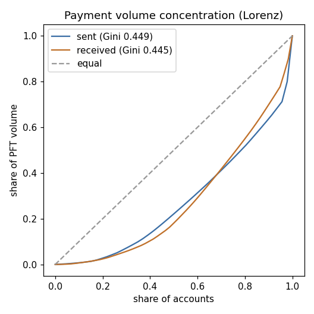
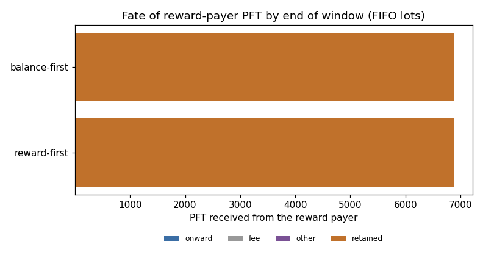

# payflow report: payment graph and reward-payer onward flows

Ledgers 7685510-7714380 (28871 fetched, 0 gaps, 0 unlisted holes), 24.25 h of close times. Counted payments: tesSUCCESS, native PFT, metadata delivered_amount > 0. Amounts in PFT (1 PFT = 1,000,000 drops); addresses truncated.

## Totals

| metric | value |
|---|---:|
| transactions (tx.csv rows / ledger txn_count sum) | 10001 / 10001 |
| payments (all results) | 7957 |
| counted payments | 7945 |
| failed payments | 12 |
| non-native / zero-delivered / partial | 0 / 0 / 0 |
| PFT volume (delivered) | 34,322.686397 |
| fees, all tx / payments only | 0.100124 / 0.079674 |
| reward payer rwdm72...SfH7: payments, PFT, share of volume | 52, 6,875.750001, 20.03 % |

## Graph

| metric | value |
|---|---:|
| accounts (senders / receivers) | 59 (46 / 58) |
| distinct edges (self-payments) | 1475 (0) |
| density | 0.43103448 |
| reciprocal pairs | 653 |
| sources / sinks / intermediaries | 1 / 13 / 45 |
| out-degree max / median | 43 / 36.0 |
| in-degree max / median | 42 / 33.5 |
| weakly connected components (largest; top 5 sizes) | 2 (45; 45, 14) |

Top edges by volume:

| from | to | payments | PFT |
|---|---|---:|---:|
| `rwdm72...SfH7` | `rpHvzM...EKkA` | 2 | 3,500.000001 |
| `rwdm72...SfH7` | `rPo8Gk...HxNx` | 2 | 2,003.750000 |
| `rQED5S...1kcR` | `r9k51c...UJGR` | 1 | 410.653468 |
| `r9k51c...UJGR` | `rEr54V...5Sxf` | 3 | 300.000000 |
| `rwdm72...SfH7` | `rKF7zT...bQSf` | 12 | 299.600000 |
| `rwAMci...E3TL` | `r9k51c...UJGR` | 1 | 276.144723 |
| `rKzL1Q...mhVZ` | `r9k51c...UJGR` | 1 | 271.425238 |
| `rwdm72...SfH7` | `rHv6jS...ZJG3` | 2 | 255.000000 |
| `rBPvTt...DVbS` | `r9k51c...UJGR` | 1 | 240.540015 |
| `rwdm72...SfH7` | `r3F4NY...pXPc` | 6 | 219.500000 |

## Concentration

| side | accounts | Gini | top-1 | top-10 | HHI | accounts for 50 % |
|---|---:|---:|---:|---:|---:|---:|
| sent | 46 | 0.4491 | 20.03 % | 50.18 % | 0.0625 | 10 |
| received | 58 | 0.4449 | 10.20 % | 41.18 % | 0.0333 | 14 |

## Net flows (received - sent, delivered PFT)

Sum over all accounts: 0 drops (0 by construction).

| account | net PFT | received | sent | fees |
|---|---:|---:|---:|---:|
| `rpHvzM...EKkA` | 3,500.000001 | 3,500.000001 | 0.000000 | 0.000000 |
| `rPo8Gk...HxNx` | 2,003.750000 | 2,003.750000 | 0.000000 | 0.000000 |
| `rKF7zT...bQSf` | 299.600000 | 299.600000 | 0.000000 | 0.000036 |
| `rHv6jS...ZJG3` | 255.000000 | 255.000000 | 0.000000 | 0.000000 |
| `rHcXeT...8EJw` | 254.797393 | 497.218997 | 242.421604 | 0.001400 |
| `r3F4NY...pXPc` | 219.500000 | 219.500000 | 0.000000 | 0.000000 |
| `rPExxz...snSk` | 203.000000 | 203.000000 | 0.000000 | 0.000000 |
| `rpgHto...X1qE` | 200.397363 | 599.055764 | 398.658401 | 0.002230 |
| `rMKRnK...YbZ9` | 158.095929 | 252.356146 | 94.260217 | 0.000480 |
| `rsJu5D...XNv9` | 156.265484 | 824.783448 | 668.517964 | 0.003330 |
| `rwdm72...SfH7` | -6,875.750001 | 0.000000 | 6,875.750001 | 0.000624 |
| `r9k51c...UJGR` | -860.675915 | 2,139.324085 | 3,000.000000 | 0.000300 |
| `rQED5S...1kcR` | -311.688985 | 700.612774 | 1,012.301759 | 0.002790 |
| `rD5BRJ...Hn42` | -234.878831 | 771.973878 | 1,006.852709 | 0.003020 |
| `rKzL1Q...mhVZ` | -218.281108 | 207.595914 | 425.877022 | 0.000760 |
| `r9qZh3...uDcR` | -208.750551 | 413.908505 | 622.659056 | 0.002530 |
| `rwAMci...E3TL` | -173.657561 | 209.032897 | 382.690458 | 0.000930 |
| `rhUyVq...f8RL` | -152.759642 | 101.819333 | 254.578975 | 0.001250 |
| `r4iUaB...dR1W` | -141.404422 | 437.615468 | 579.019890 | 0.001870 |
| `rh1n36...aKAq` | -138.219156 | 611.450382 | 749.669538 | 0.003130 |

## Reward-payer onward flows

13 accounts received PFT from rwdm72...SfH7. Each recipient's balance is replayed from its snapshot balance through every metadata balance change; reward receipts are FIFO lots. `reward_first` spends lots before other balance (upper bound of onward flow), `balance_first` spends them last (lower bound).

| policy | received | onward | fees | other | retained | to payer | to other recipients | destinations | median hold | mismatches |
|---|---:|---:|---:|---:|---:|---:|---:|---:|---:|---:|
| reward_first | 6,875.750001 | 0.000000 (0.00 %) | 0.000048 | 0.000000 | 6,875.749953 (100.00 %) | 0.000000 | 0.000000 | 0 | - | 0 |
| balance_first | 6,875.750001 | 0.000000 (0.00 %) | 0.000000 | 0.000000 | 6,875.750001 (100.00 %) | 0.000000 | 0.000000 | 0 | - | 0 |

Top onward destinations (reward_first):

| account | PFT | payer | recipient |
|---|---:|---|---|

Recipients absent from the start snapshot (opening balance 0, created in window): 1.

## Charts

