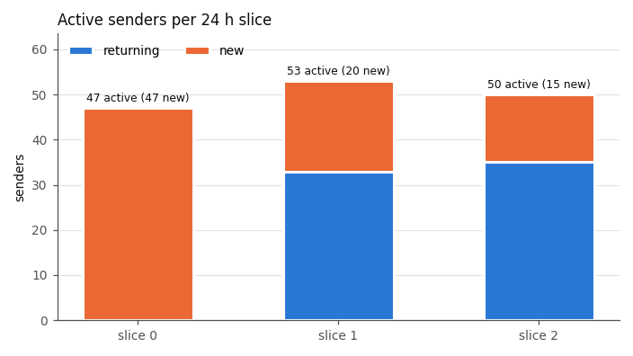
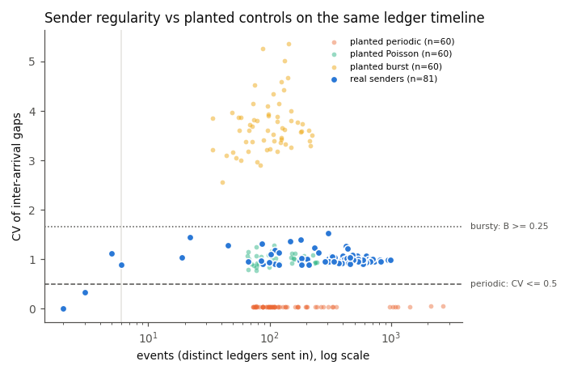
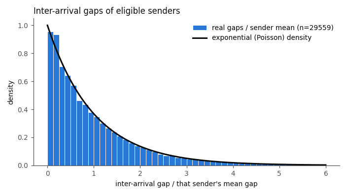

# senders: 72 h sender activity report

Ledgers 7634323-7720573 (86251 fetched, 0 gaps, 0 unlisted holes, 0 duplicates), 72.5 h of close time cut into 3 slices of 24 h (the last one absorbs the remainder). Generated by `senders/report_senders.py`; every number below is computed from the committed data.

## Totals

| measure | value |
|---|---|
| transactions (tx.csv rows) | 29650 |
| sum of ledger `txn_count` | 29650 |
| distinct senders | 82 |
| senders with >= 6 events (classifiable) | 76 |
| fees | 296820 drops |
| failed (result != tesSUCCESS) | 33 (0.1 %) |

## Daily active, new and returning senders

| slice | active | new | returning | transactions |
|---|---|---|---|---|
| 0 | 47 | 47 | 0 | 9686 |
| 1 | 53 | 20 | 33 | 9845 |
| 2 | 50 | 15 | 35 | 10119 |

"New" is window-relative: first seen in this window.

## Retention (cohort = slice of first appearance)

| cohort | size | slice 0 | slice 1 | slice 2 |
|---|---|---|---|---|
| 0 | 47 | 47 (100.0 %) | 33 (70.2 %) | 15 (31.9 %) |
| 1 | 20 | - | 20 (100.0 %) | 20 (100.0 %) |
| 2 | 15 | - | - | 15 (100.0 %) |

## Classes

Rule (fixed constants in `analyze_senders.py`): *periodic* if n >= 6, CV <= 0.5 and >= 60% of gaps within +-20% of the median gap; *bursty* if burstiness B >= 0.25; otherwise *sporadic* (including every sender with fewer than 6 events).

| class | senders | share | transactions | share | fees (drops) | share | failed | share of failures | fail rate |
|---|---|---|---|---|---|---|---|---|---|
| periodic | 0 | 0.0 % | 0 | 0.0 % | 0 | 0.0 % | 0 | 0.0 % | 0.00% |
| bursty | 0 | 0.0 % | 0 | 0.0 % | 0 | 0.0 % | 0 | 0.0 % | 0.00% |
| sporadic | 82 | 100.0 % | 29650 | 100.0 % | 296820 | 100.0 % | 33 | 100.0 % | 0.11% |

## Regularity and dominant period (eligible senders)

| statistic | q1 | median | q3 |
|---|---|---|---|
| CV of gaps | 0.955 | 1.001 | 1.043 |
| burstiness B | -0.023 | 0.001 | 0.021 |
| period share (gaps within +-20% of median) | 0.125 | 0.137 | 0.154 |
| dominant period = median gap (s) | 170.0 | 181.0 | 200.2 |
| mean gap (s) | 254.4 | 271.5 | 285.0 |

Median gap / mean gap: median 0.684 (an exponential distribution gives ln 2 = 0.693, a clock gives 1.0).

## Most active senders (addresses truncated)

| sender | tx | events | median gap (s) | CV | B | period share | class | top type | failed |
|---|---|---|---|---|---|---|---|---|---|
| rMzGUd...i7TE | 991 | 991 | 170.5 | 0.984 | -0.008 | 0.139 | sporadic | Payment | 3 |
| rU24E8...Wd6Y | 942 | 942 | 189.0 | 0.985 | -0.008 | 0.146 | sporadic | Payment | 0 |
| rp2m3d...MvLQ | 822 | 822 | 191.0 | 0.959 | -0.021 | 0.121 | sporadic | Payment | 9 |
| rQED5S...1kcR | 808 | 808 | 199.0 | 0.993 | -0.003 | 0.130 | sporadic | Payment | 0 |
| r4iUaB...dR1W | 725 | 725 | 201.0 | 0.955 | -0.023 | 0.138 | sporadic | Payment | 0 |
| r9YBTn...WkMf | 708 | 708 | 192.0 | 1.002 | 0.001 | 0.146 | sporadic | Payment | 0 |
| rEFrJH...k85j | 689 | 689 | 194.5 | 1.027 | 0.013 | 0.126 | sporadic | Payment | 0 |
| rhUyVq...f8RL | 679 | 679 | 166.0 | 1.019 | 0.010 | 0.117 | sporadic | Payment | 0 |
| rhGfdd...h3Na | 675 | 675 | 191.5 | 0.957 | -0.022 | 0.148 | sporadic | Payment | 0 |
| r9qZh3...uDcR | 667 | 667 | 178.5 | 0.955 | -0.023 | 0.153 | sporadic | Payment | 0 |

Top periodic senders: none (no sender meets the periodic rule).

## Transaction types

| type | transactions | share |
|---|---|---|
| Payment | 23246 | 78.4 % |
| NFTokenMint | 3229 | 10.9 % |
| NFTokenBurn | 3175 | 10.7 % |

## Controls

| control | expected | correct | classes | result |
|---|---|---|---|---|
| periodic | periodic | 200/200 | {'periodic': 200} | PASS |
| poisson | sporadic | 200/200 | {'sporadic': 200} | PASS |
| burst | bursty | 200/200 | {'bursty': 200} | PASS |
| planted-periodic | periodic | 200/200 | {'periodic': 200} | PASS |
| planted-poisson | sporadic | 200/200 | {'sporadic': 200} | PASS |
| planted-burst | bursty | 200/200 | {'bursty': 200} | PASS |

Shuffled-timestamp negative control: 76 eligible senders, real classes {'sporadic': 76}, shuffled classes {'sporadic': 76}, real periodic that stayed periodic 0/0; median CV real 1.001 vs shuffled 0.997: PASS.
