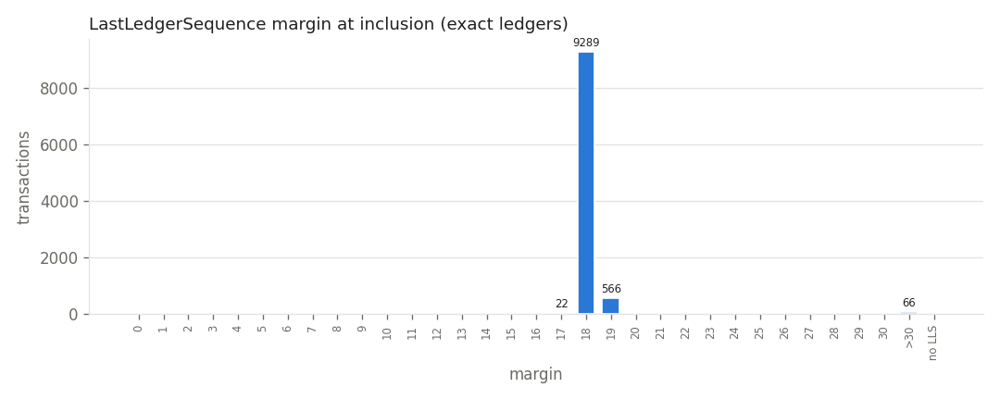
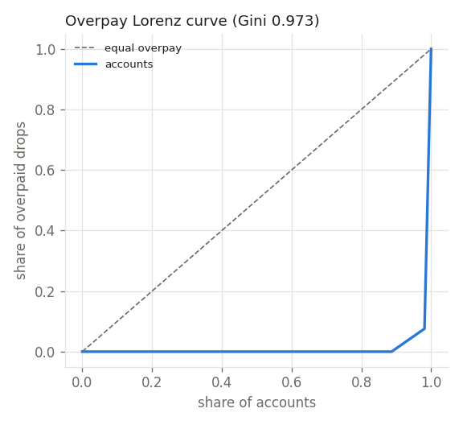
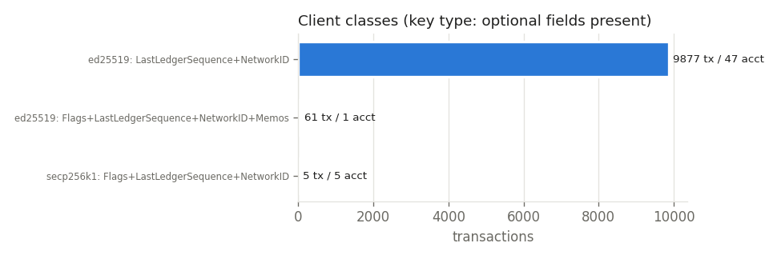

# Transaction-construction hygiene, Post Fiat testnet

Window 2026-11-07T02:14:20Z -> 2026-11-08T02:29:20Z (collector clock); ledgers 7829493-7858346 (28854 ledgers, closes 2026-11-07T02:14:20Z .. 2026-11-08T02:29:20Z); 9943 validated transactions from 53 accounts. Generated by `txhygiene/analyze_txhygiene.py` from `txhygiene/data/tx/`; every number below is in `txhygiene/report/txhygiene.json`.

Types: NFTokenBurn 887, NFTokenMint 1033, Payment 8023. Results: tecUNFUNDED_PAYMENT 3, tesSUCCESS 9940. Account activity: top-1 account 3.5 %, top-5 16.9 % of all tx (Gini 0.369).

## 1. Expiry: LastLedgerSequence margin at inclusion

Margin = `LastLedgerSequence - ledger_index` of the ledger that included the tx: how many more ledgers the tx could have waited. A tx without LastLedgerSequence never expires; if it is delayed (queue, low fee, sequence hole) it can apply much later than its sender expects.

- with LastLedgerSequence: 9943 / 9943; without: 0 (0 %) from 0 account(s); negative margins: 0
- margin quantiles (min / p10 / median / p90 / max): 17 / 18 / 18 / 18 / 119

| margin (ledgers) | tx |
|---|---|
| <0 | 0 |
| 0-1 | 0 |
| 2-4 | 0 |
| 5-10 | 0 |
| 11-20 | 9877 |
| 21-100 | 0 |
| >100 | 66 |

Exact margins: 17: 22, 18: 9289, 19: 566, 118: 49, 119: 17.

| type | tx | no LLS | min | median | max |
|---|---|---|---|---|---|
| NFTokenBurn | 887 | 0 | 17 | 18 | 19 |
| NFTokenMint | 1033 | 0 | 17 | 18 | 118 |
| Payment | 8023 | 0 | 17 | 18 | 119 |

## 2. Fees: paid vs required, overpay concentration, escalation

Required = base fee of the newest `fee` sample taken before the tx's ledger closed, times (1 + signers) for multi-signed tx. Overpay = fee - required (drops). The open-ledger fee is sampled once per validated ledger (28702 samples).

- base fee values seen: {10: 28702}; tx matched to a sample 9943, unmatched 0
- fee quantiles in drops (min / median / p90 / p99 / max): 10 / 10 / 10 / 10 / 12
- fee / required (median / p90 / p99 / max): 1 / 1 / 1 / 1.2
- below required: 0; paid below the sampled open-ledger fee: 0
- overpaying tx 66; overpay 132 of 99562 fee drops (required 99430)
- overpay by account: 6 of 53 accounts overpay; Gini 0.973, top-1 92.4 %, top-5 98.5 %
- escalation: open-ledger fee above base in 0 of 28702 samples (0 %); max open-ledger fee 10 drops; max queue 0

| fee / required | tx |
|---|---|
| <1x | 0 |
| 1x (exact) | 9877 |
| >1-2x | 66 |
| >2-10x | 0 |
| >10-100x | 0 |
| >100x | 0 |

| account (HMAC prefix) | overpay drops |
|---|---|
| 6efdc80b | 122 |
| 41731c26 | 2 |
| 810d756a | 2 |
| 81ebe2b0 | 2 |
| 9f4fb105 | 2 |

## 3. Signing algorithms

From the SigningPubKey prefix only (`ED` = ed25519, `02`/`03` = secp256k1, empty with Signers = multisig). No public key is stored.

| key type | tx |
|---|---|
| ed25519 | 9938 |
| secp256k1 | 5 |

| key types used by an account | accounts |
|---|---|
| ed25519 | 48 |
| secp256k1 | 5 |

Multisig signer counts: none. tfFullyCanonicalSig flag set on 0 tx (the flag is ignored once RequireFullyCanonicalSig is enabled).

## 4. Sequences and tickets

- Sequence-based tx 9943, Ticket-based tx 0
- accounts with 2+ Sequence tx in the window: 48; steps between consecutive tx of one account: +1 9890, >+1 0, <=0 0 (a validated tx always consumes exactly its Sequence, so >+1 means the account used sequences outside these tx types, e.g. TicketCreate, or the window misses a tx)
- tx per (account, ledger): 1: 9943
- ledger_index - Sequence (min / median / max): 6 / 31537 / 7849704 (an account's first Sequence is the ledger index it was created in)

## 5. Optional fields

| field | tx | % |
|---|---|---|
| no_network_id | 0 | 0 |
| source_tag | 0 | 0 |
| dest_tag | 0 | 0 |
| account_txn_id | 0 | 0 |
| memos | 61 | 0.61 |
| flags_nonzero | 5 | 0.05 |
| flags_field_absent | 9877 | 99.34 |

NetworkID values: {'2025': 9943}.

## 6. Field-set client fingerprints

Class = key type + which generic optional fields the client put in the tx (Flags, LastLedgerSequence, NetworkID, Memos, SourceTag, AccountTxnID, TicketSequence). Server-added keys (hash, metaData, DeliverMax, ...) are excluded.

| class | tx | accounts |
|---|---|---|
| ed25519: LastLedgerSequence+NetworkID | 9877 | 47 |
| ed25519: Flags+LastLedgerSequence+NetworkID+Memos | 61 | 1 |
| secp256k1: Flags+LastLedgerSequence+NetworkID | 5 | 5 |

Accounts seen with more than one class: 0. Distinct (type, full field set) combinations: 5:

| type | field set | tx | accounts |
|---|---|---|---|
| Payment | Account Amount Destination Fee LastLedgerSequence NetworkID Sequence SigningPubKey TransactionType TxnSignature | 7962 | 47 |
| NFTokenMint | Account Fee LastLedgerSequence NFTokenTaxon NetworkID Sequence SigningPubKey TransactionType TxnSignature URI | 1028 | 44 |
| NFTokenBurn | Account Fee LastLedgerSequence NFTokenID NetworkID Sequence SigningPubKey TransactionType TxnSignature | 887 | 44 |
| Payment | Account Amount Destination Fee Flags LastLedgerSequence Memos NetworkID Sequence SigningPubKey TransactionType TxnSignature | 61 | 1 |
| NFTokenMint | Account Fee Flags LastLedgerSequence NFTokenTaxon NetworkID Sequence SigningPubKey TransactionType TransferFee TxnSignature URI | 5 | 5 |

